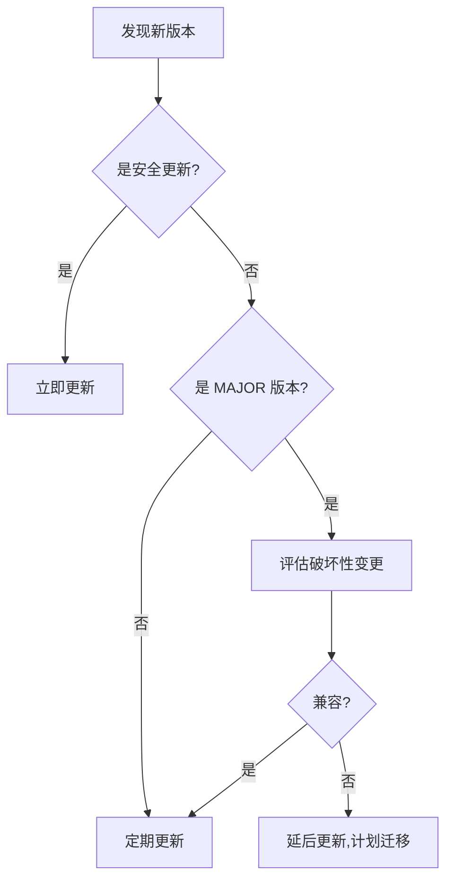

# 安全修复知识点总结

**项目：** CVE-2025-55182/66478 漏洞分析与修复  
**日期：** 2025年12月8日  
**类型：** 安全加固与漏洞修复

---

## 📚 核心知识点

### 1. React Server Components (RSC) 安全

#### 什么是 React Server Components？
- React 19 引入的新特性
- 组件在服务器端渲染，减少客户端 JavaScript
- 默认情况下 Next.js App Router 的组件都是 Server Components

#### 安全风险
- **序列化/反序列化漏洞**：服务器和客户端数据传输需要序列化
- **代码注入风险**：未验证的数据可能包含恶意代码
- **原型污染**：JavaScript 原型链可能被污染

#### 最佳实践
```typescript
// ❌ 危险：直接使用未验证的数据
const data = await request.json();
processData(data);

// ✅ 安全：先验证再使用
const schema = z.object({
  name: z.string().max(100),
  value: z.number().positive(),
});
const validatedData = schema.parse(await request.json());
processData(validatedData);
```

---

### 2. Next.js App Router 安全

#### App Router vs Pages Router
| 特性 | Pages Router | App Router |
|------|--------------|------------|
| 路由方式 | pages/ 目录 | app/ 目录 |
| 默认渲染 | 客户端 | 服务器端 |
| 数据获取 | getServerSideProps | async 组件 |
| 安全风险 | 较低 | 较高（需额外防护） |

#### 安全要点
1. **Server Actions 验证**：所有 Server Actions 必须验证输入
2. **环境变量隔离**：使用 `NEXT_PUBLIC_` 前缀控制暴露
3. **API Routes 保护**：添加认证和授权检查

#### 示例：安全的 Server Action
```typescript
// app/actions.ts
'use server'

import { z } from 'zod';

const schema = z.object({
  userId: z.string().uuid(),
  action: z.enum(['create', 'update', 'delete']),
});

export async function performAction(formData: FormData) {
  // 1. 验证输入
  const data = schema.parse({
    userId: formData.get('userId'),
    action: formData.get('action'),
  });
  
  // 2. 验证权限
  const user = await getCurrentUser();
  if (!user || !hasPermission(user, data.action)) {
    throw new Error('Unauthorized');
  }
  
  // 3. 执行操作
  return await executeAction(data);
}
```

---

### 3. 依赖管理与安全更新

#### 语义化版本 (SemVer)
```
版本号：MAJOR.MINOR.PATCH
例如：  15.2.6

MAJOR: 重大变更，可能不兼容
MINOR: 新功能，向后兼容
PATCH: 修复 bug，向后兼容
```

#### package.json 版本前缀
```json
{
  "dependencies": {
    "next": "15.2.6",     // 精确版本（锁定）
    "react": "^19.0.1",   // 兼容版本（允许 MINOR 和 PATCH 更新）
    "axios": "~1.8.4"     // 近似版本（仅允许 PATCH 更新）
  }
}
```

#### 最佳实践
1. **定期更新**：每周检查 `npm outdated`
2. **安全审计**：每天运行 `npm audit`
3. **锁定版本**：使用 `package-lock.json`
4. **自动化**：配置 Dependabot 自动更新

#### 安全更新流程
```bash
# 1. 检查过时的包
npm outdated

# 2. 检查安全漏洞
npm audit

# 3. 自动修复（仅 PATCH 和 MINOR）
npm audit fix

# 4. 修复所有（包括 MAJOR，可能破坏兼容性）
npm audit fix --force

# 5. 验证应用
npm test
npm run dev
```

---

### 4. Web 应用安全中间件

#### 什么是中间件？
在请求到达应用之前拦截和处理请求的代码层。

#### Next.js 中间件执行流程
```
请求 → 中间件 → 路由处理器 → 响应
         ↓
    速率限制
    安全检查
    日志记录
    添加响应头
```

#### 核心安全功能

##### 1) 速率限制 (Rate Limiting)
**目的：** 防止 DDoS 攻击和暴力破解

**实现原理：**
```typescript
// 简化版实现
const requests = new Map<string, number[]>();

function checkRateLimit(ip: string): boolean {
  const now = Date.now();
  const userRequests = requests.get(ip) || [];
  
  // 过滤最近 60 秒的请求
  const recentRequests = userRequests.filter(
    time => now - time < 60000
  );
  
  // 超过限制？
  if (recentRequests.length >= 100) {
    return false;
  }
  
  // 记录本次请求
  recentRequests.push(now);
  requests.set(ip, recentRequests);
  return true;
}
```

**生产环境建议：** 使用 Redis 存储，支持分布式部署

##### 2) 安全响应头 (Security Headers)
**目的：** 防止常见的 Web 攻击

| 响应头 | 作用 | 推荐值 |
|--------|------|--------|
| X-Frame-Options | 防止点击劫持 | DENY |
| X-Content-Type-Options | 防止 MIME 嗅探 | nosniff |
| X-XSS-Protection | 防止 XSS 攻击 | 1; mode=block |
| Content-Security-Policy | 限制资源加载 | 根据需求配置 |
| Strict-Transport-Security | 强制 HTTPS | max-age=31536000 |

**CSP 示例：**
```
Content-Security-Policy: 
  default-src 'self';
  script-src 'self' 'unsafe-inline' https://trusted.cdn.com;
  style-src 'self' 'unsafe-inline';
  img-src 'self' data: https:;
  font-src 'self' data:;
  connect-src 'self' https://api.yourdomain.com;
```

##### 3) 输入验证 (Input Validation)
**常见攻击模式：**

```typescript
const suspiciousPatterns = {
  // 路径遍历
  pathTraversal: /\.\.\//,
  
  // XSS 注入
  xss: /<script|<iframe|javascript:|onerror=/i,
  
  // SQL 注入
  sqlInjection: /union.*select|drop.*table|insert.*into/i,
  
  // 命令注入
  commandInjection: /;.*ls|&&.*cat|`.*whoami/,
  
  // 原型污染
  prototypePollution: /__proto__|constructor|prototype/,
};
```

---

### 5. CORS（跨域资源共享）安全

#### 什么是 CORS？
浏览器安全机制，限制网页从不同源加载资源。

#### 源 (Origin) 的定义
```
协议 + 域名 + 端口 = 源

https://example.com:443  ← 完整的源
https://api.example.com  ← 不同的源（子域名不同）
http://example.com       ← 不同的源（协议不同）
```

#### CORS 配置安全等级

```javascript
// ❌ 危险：允许所有来源
{ 'Access-Control-Allow-Origin': '*' }

// ⚠️ 一般：允许多个来源
{ 'Access-Control-Allow-Origin': 'https://app1.com,https://app2.com' }

// ✅ 安全：动态验证来源
const allowedOrigins = ['https://app.com', 'https://admin.app.com'];
const origin = request.headers.get('origin');
if (allowedOrigins.includes(origin)) {
  response.headers.set('Access-Control-Allow-Origin', origin);
}
```

#### 预检请求 (Preflight)
浏览器在发送实际请求前，先发送 OPTIONS 请求检查权限：

```
OPTIONS /api/data HTTP/1.1
Origin: https://example.com
Access-Control-Request-Method: POST
Access-Control-Request-Headers: Content-Type

↓

HTTP/1.1 200 OK
Access-Control-Allow-Origin: https://example.com
Access-Control-Allow-Methods: GET, POST
Access-Control-Allow-Headers: Content-Type
Access-Control-Max-Age: 86400
```

---

### 6. 环境变量安全

#### 环境变量类型

| 类型 | 前缀 | 可见性 | 用途 | 示例 |
|------|------|--------|------|------|
| 公开 | NEXT_PUBLIC_ | 客户端+服务器 | 非敏感配置 | API URL |
| 私有 | 无 | 仅服务器 | 敏感信息 | 密钥、密码 |

#### 安全规则

```bash
# ✅ 好的做法
NEXT_PUBLIC_API_URL=https://api.example.com  # 非敏感
JWT_SECRET=<strong-random-key>               # 仅服务器

# ❌ 危险做法
NEXT_PUBLIC_JWT_SECRET=secret123  # 敏感信息暴露到客户端！
```

#### 密钥生成

```bash
# 方法1：OpenSSL
openssl rand -base64 32

# 方法2：Node.js
node -e "console.log(require('crypto').randomBytes(32).toString('base64'))"

# 方法3：在线工具
# https://www.uuidgenerator.net/
```

#### .gitignore 配置

```gitignore
# 环境变量文件
.env
.env.local
.env.*.local

# 但可以提交示例文件
!.env.example
```

---

### 7. 输入验证与 Schema 验证

#### 为什么需要验证？
1. **防止注入攻击**：SQL、XSS、命令注入
2. **数据完整性**：确保数据符合预期格式
3. **业务逻辑**：满足业务规则

#### Zod Schema 验证

```typescript
import { z } from 'zod';

// 基础类型
const stringSchema = z.string();
const numberSchema = z.number();
const booleanSchema = z.boolean();

// 约束条件
const usernameSchema = z
  .string()
  .min(3, '用户名至少3个字符')
  .max(20, '用户名最多20个字符')
  .regex(/^[a-zA-Z0-9_]+$/, '只能包含字母、数字和下划线');

// 对象验证
const userSchema = z.object({
  username: usernameSchema,
  email: z.string().email('无效的邮箱地址'),
  age: z.number().int().min(18).max(120),
  role: z.enum(['admin', 'user', 'guest']),
});

// 使用
try {
  const validData = userSchema.parse(inputData);
  // 验证通过，使用 validData
} catch (error) {
  if (error instanceof z.ZodError) {
    // 验证失败，返回错误信息
    console.log(error.errors);
  }
}

// 可选字段
const profileSchema = z.object({
  bio: z.string().optional(),
  avatar: z.string().url().nullable(),
});

// 数组验证
const tagsSchema = z.array(z.string()).min(1).max(10);

// 联合类型
const idSchema = z.union([
  z.string().uuid(),
  z.number().positive(),
]);
```

---

### 8. 日志与监控

#### 安全日志应包含的信息

```typescript
interface SecurityLogEntry {
  timestamp: string;       // ISO 8601 格式
  level: 'info' | 'warn' | 'error' | 'critical';
  event: string;          // 事件类型
  ip: string;             // 客户端 IP
  userId?: string;        // 用户 ID（如已登录）
  url: string;            // 请求 URL
  method: string;         // HTTP 方法
  userAgent: string;      // User-Agent
  details?: any;          // 额外信息
}
```

#### 日志级别使用

```typescript
// INFO: 正常操作
logger.info('用户登录', { userId: '123' });

// WARN: 可疑但未阻止
logger.warn('速率限制警告', { ip: '1.2.3.4', count: 80 });

// ERROR: 错误但应用仍运行
logger.error('API 调用失败', { error: err.message });

// CRITICAL: 严重安全事件
logger.critical('可疑攻击尝试', { 
  ip: '1.2.3.4',
  pattern: 'SQL injection',
});
```

#### 监控指标

**应用层：**
- 请求速率 (req/s)
- 响应时间 (ms)
- 错误率 (%)
- 4xx/5xx 状态码比例

**安全层：**
- 速率限制触发次数
- 可疑请求数量
- 认证失败次数
- 异常登录尝试

---

## 🎯 实战技巧

### 1. 快速识别 CVE 风险等级

| CVSS 评分 | 等级 | 响应时间 |
|-----------|------|----------|
| 9.0-10.0 | 严重 | 立即修复（24小时内） |
| 7.0-8.9 | 高危 | 紧急修复（1周内） |
| 4.0-6.9 | 中危 | 计划修复（1月内） |
| 0.1-3.9 | 低危 | 观察评估 |

### 2. 依赖更新策略



### 3. 安全检查清单

**每次部署前：**
- [ ] 运行 `npm audit`
- [ ] 检查环境变量配置
- [ ] 验证 CORS 设置
- [ ] 测试速率限制
- [ ] 检查响应头

**每周：**
- [ ] 审查安全日志
- [ ] 检查 `npm outdated`
- [ ] 更新依赖包
- [ ] 代码安全扫描

**每月：**
- [ ] 全面安全审计
- [ ] 渗透测试
- [ ] 更新安全文档
- [ ] 团队安全培训

---

## 💡 常见问题与解决方案

### Q1: 如何平衡安全性和用户体验？

**问题：** 速率限制太严格，正常用户也被限制

**解决方案：**
```typescript
// 分级速率限制
const rateLimits = {
  guest: { window: 60000, max: 10 },      // 游客：低限制
  authenticated: { window: 60000, max: 100 }, // 已登录：中等限制
  premium: { window: 60000, max: 1000 },  // 付费用户：高限制
};

function getRateLimit(user) {
  if (!user) return rateLimits.guest;
  if (user.isPremium) return rateLimits.premium;
  return rateLimits.authenticated;
}
```

### Q2: 生产环境如何管理密钥？

**不要：** 将密钥写在 `.env` 文件中并部署

**推荐：**
1. **云服务商密钥管理**
   - AWS Secrets Manager
   - Azure Key Vault
   - Google Cloud Secret Manager

2. **容器环境变量**
   ```yaml
   # docker-compose.yml
   services:
     app:
       environment:
         - JWT_SECRET=${JWT_SECRET}  # 从主机环境读取
   ```

3. **CI/CD 密钥存储**
   - GitHub Secrets
   - GitLab CI/CD Variables
   - Jenkins Credentials

### Q3: 如何处理第三方依赖的漏洞？

**场景：** 项目依赖的某个包有漏洞,但没有修复版本

**解决方案：**
1. **评估影响**：漏洞是否影响你的使用场景？
2. **寻找替代**：是否有其他安全的包？
3. **临时缓解**：
   ```json
   // package.json
   {
     "overrides": {
       "vulnerable-package": "safe-version"
     }
   }
   ```
4. **监控跟踪**：设置提醒，等待官方修复

---

## 📖 延伸阅读

### 官方文档
- [Next.js Security](https://nextjs.org/docs/advanced-features/security-headers)
- [React Security](https://react.dev/learn/security)
- [Node.js Security Best Practices](https://nodejs.org/en/docs/guides/security/)

### 安全标准
- [OWASP Top 10](https://owasp.org/www-project-top-ten/)
- [CWE Top 25](https://cwe.mitre.org/top25/)
- [NIST Cybersecurity Framework](https://www.nist.gov/cyberframework)

### 工具推荐
- **依赖检查：** Snyk, npm audit, GitHub Dependabot
- **代码扫描：** SonarQube, CodeQL, ESLint security plugins
- **渗透测试：** OWASP ZAP, Burp Suite
- **监控：** Sentry, LogRocket, Datadog

---

## 🏆 总结

通过本次安全修复项目,我们学到了：

1. **及时更新的重要性**：小版本更新可能修复严重漏洞
2. **深度防御策略**：不依赖单一防护,多层安全措施
3. **自动化安全检查**：工具化、脚本化减少人为疏漏
4. **完整的文档**：详细记录便于团队理解和后续维护
5. **持续学习**：安全是一个持续的过程,不是一次性任务

**安全格言：** 
> "Security is not a product, but a process." 
> 安全不是产品,而是一个过程。 - Bruce Schneier

---

**编写时间：** 2025年12月8日  
**适用对象：** Web 开发者、安全工程师、技术团队

